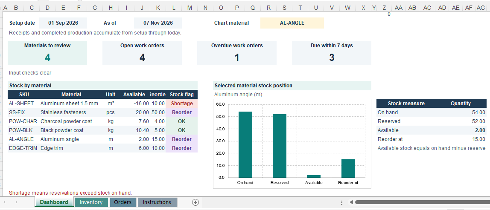
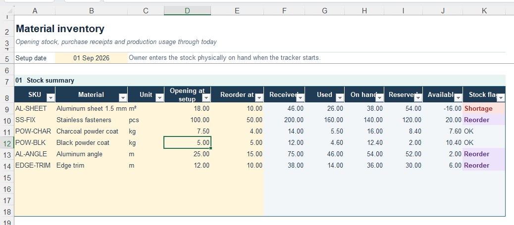
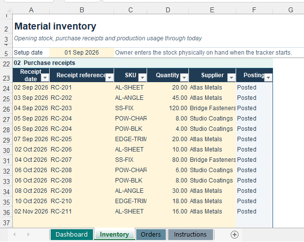
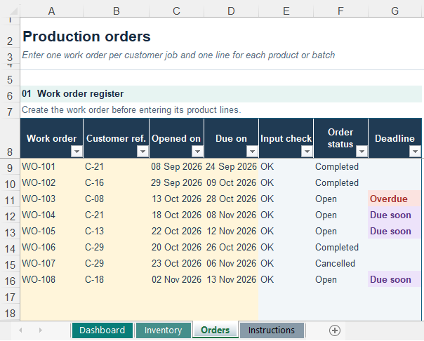
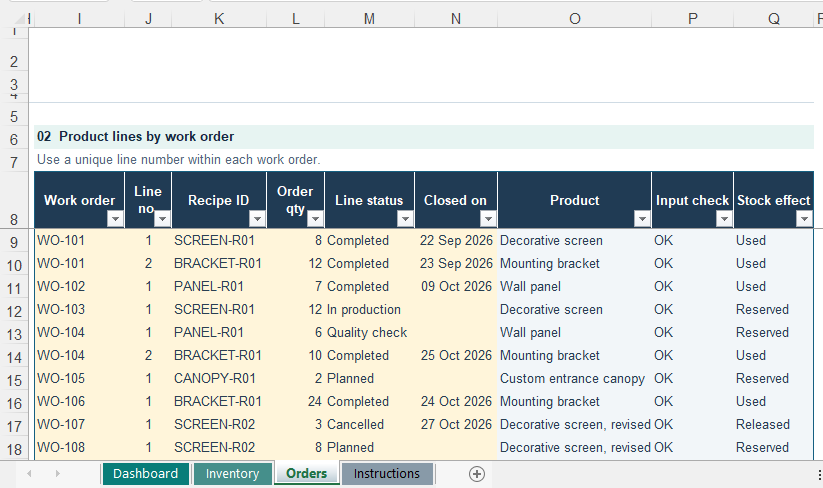
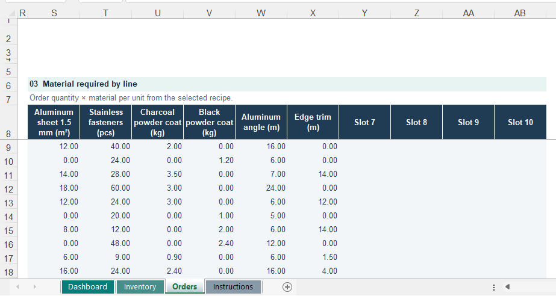
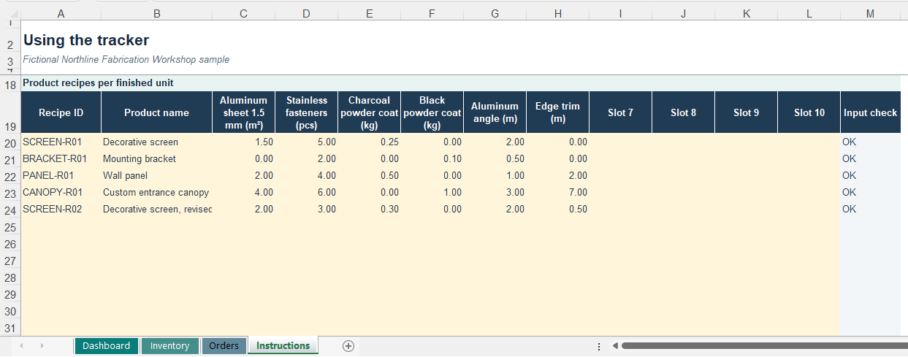

# Excel Inventory & Production Tracker

An Excel portfolio project for a fictional custom manufacturing workshop. The workbook connects material purchases, product recipes and production orders to a cumulative inventory summary and dashboard.

[Download the Excel workbook](https://raw.githubusercontent.com/yohannes-data/excel-inventory-production-tracker/refs/heads/main/Excel_Inventory_Production_Portfolio.xlsx)

Select a screenshot to open the image at its full size.

## Business problem

A small manufacturer needs to know how much raw material is physically on hand, how much is reserved for current orders, and how much is available for new work. A customer order can contain several products, each with its own material requirements and production status.

This workbook links those records through formulas, structured tables, dropdowns and stock alerts. Northline Fabrication Workshop and all sample customers, suppliers, orders and quantities are fictional.

## Workbook structure

| Sheet | Contents |
|---|---|
| Dashboard | Stock alerts, order indicators, material selector, chart and selected-material quantities |
| Inventory | Setup date, material stock summary and purchase-receipt log |
| Orders | Work-order register, product lines and calculated material requirements |
| Instructions | Daily workflow and material recipes per finished unit |

## 1. Review the dashboard

Select a material in the pale-yellow **Chart material** dropdown. The chart and quantity table show that material's on-hand, reserved, available and reorder quantities in its own unit.

The dashboard also shows materials to review, open work orders, overdue work orders and orders due within seven days.

The reporting period runs from one **Setup date** through **today**. Opening stock is the quantity physically on hand when the tracker starts. Receipts and completed production accumulate after that starting point. Deadline indicators change as the current date advances.

## 2. Set up materials and opening stock

On **Inventory**, the owner enters the setup date and these fields for each material.

| Input | Meaning |
|---|---|
| SKU | A unique material identifier |
| Material | Material name |
| Unit | The measurement unit, such as pcs, m, m² or kg |
| Opening at setup | Physical quantity on hand at the setup date |
| Reorder at | Available-stock level that triggers a reorder flag |

The remaining stock columns calculate from receipts and production lines.

| Calculated quantity | Calculation |
|---|---|
| Received | Total eligible purchase receipts through today |
| Used | Recipe quantities for completed production lines through today |
| On hand | Opening stock + received − used |
| Reserved | Material required by open production lines |
| Available | On hand − reserved |

**Shortage** means available stock is negative. **Reorder** means available stock is at or below the reorder level. **OK** means it is above that level.

Add new materials in the next blank material slot. Keep each material's SKU and slot stable because recipe columns correspond to those slots. Use the same unit in setup, receipts and recipes.

For live use, save a separate copy, clear the fictional entries from the input areas, then enter the actual setup date, materials, opening stock and recipes before recording transactions.

## 3. Record every material receipt

Enter one row per received material with its **Receipt date**, **Receipt reference**, **SKU**, **Quantity** and **Supplier**. A purchase containing several materials uses several rows, which can share the receipt reference.

The **Posting** column calculates automatically. Correct rows flagged **Check input**. Future-dated receipts are excluded from received stock until their date is reached. Use receipt dates on or after the setup date.

## 4. Create a work order

On **Orders**, create one work-order record for the customer job before entering its product lines. Enter the **Work order**, **Customer ref.**, **Opened on** and **Due on** fields.

Use a unique work-order ID. A single order can contain several different products. Its calculated status reflects the linked product lines, so an order with an unfinished line remains open even when another line is completed.

## 5. Add the products within that order

For each product or batch, enter a row in **Product lines by work order**.

| Input | How to enter it |
|---|---|
| Work order | Select the existing work-order ID |
| Line no. | Enter a positive whole number unique within that work order |
| Recipe ID | Select the recipe for the product or custom variant |
| Order qty | Enter the number of finished units as a positive whole number |
| Line status | Select the current production stage |
| Closed on | Enter the close date for completed or cancelled lines |

Several rows can share a work-order ID. Each must have its own line number. Product name, input check and stock effect calculate automatically.

| Line status | Stock treatment |
|---|---|
| Planned | Reserves the line's material requirement |
| In production | Keeps the line's material requirement reserved |
| Quality check | Keeps the line's material requirement reserved |
| Completed | Counts the material requirement as used when the close date is reached |
| Cancelled | Releases the reservation when the close date is reached |

Leave **Closed on** blank for active lines. If you reopen a completed or cancelled line, clear its close date and choose an active status. Correct **Check input** flags before relying on that line's stock quantities.

## 6. Inspect the material requirement for each line

The **Material required by line** section is the horizontal continuation of the product-line table on **Orders**. Each row corresponds to the product line on the same Excel row in the preceding screenshot.

For each material, the calculation is **Order quantity × material quantity per finished unit**. For example, 8 decorative screens using 1.50 m² of aluminum sheet each require 12.00 m² for the line.

The stock summary uses the line status to determine whether those quantities are reserved, used or released. The requirement section itself shows the full recipe requirement for each valid line.

## 7. Maintain standard and custom product recipes

On **Instructions**, use one row per recipe. Enter a unique **Recipe ID**, the **Product name**, and the quantity of each material needed for **one finished unit**. Material names and units appear in the column headers.

Standard products reuse the same recipe across orders. For a custom product, enter its per-unit quantities under a new recipe ID, then select that ID on the order line. Different products in the same customer order can use different recipes.

Create a new recipe ID when a design or its material quantities change. Keep recipes already used by earlier orders intact because order lines continue to refer to their selected recipe.

## Try a short example

1. Download the workbook and save a working copy.
2. Select **SS-FIX** on **Dashboard** and note its quantities.
3. Create work order **WO-DEMO** on **Orders** with customer reference **DEMO**, today's opening date and tomorrow's due date.
4. Add line **1** under **WO-DEMO**, recipe **BRACKET-R01**, order quantity **3**, status **Planned**, and a blank close date.
5. Return to **Dashboard**. Each mounting bracket requires 2 stainless fasteners, so reserved fasteners increase by **6** and available fasteners decrease by **6**.
6. Change the product line to **Completed** and enter today's date in **Closed on**.
7. Review the result. Used fasteners increase by **6**, on-hand stock decreases by **6**, and the line's reservation is removed. Completion transfers the line's requirement from reserved to used, so available stock remains at the level after reservation.

## Inputs, status colors and protection

| Color | Meaning |
|---|---|
| Pale yellow | Input areas, including dropdowns and owner-controlled setup or recipes |
| Lavender | Reorder or due-soon warnings |
| Light red | Shortages, overdue items or input errors |
| Light green | OK status on the dashboard |

Routine receipt and order entry cells are editable. Setup, recipe and calculation cells are protected. The demonstration sheet password is **tracker**.

In Excel desktop, the owner can use **Review → Unprotect Sheet**, enter the password, update setup or recipes, then use **Review → Protect Sheet** again. Cell locking takes effect while the sheet is protected.

## Scope and sample capacity

- The workbook includes space for **10 materials**, **150 purchase receipts**, **60 work orders**, **150 product lines** and **32 recipes**.
- Used quantities follow the selected recipe when a line is completed. This represents planned recipe consumption, and actual consumption can differ.
- Split quantities into separate product lines when batches complete at different times.
- Recipe revisions and consistent material units are part of maintaining accurate records.

## Tools and techniques

Microsoft Excel, structured tables, formulas, data-validation dropdowns, conditional formatting, charts and worksheet protection.
